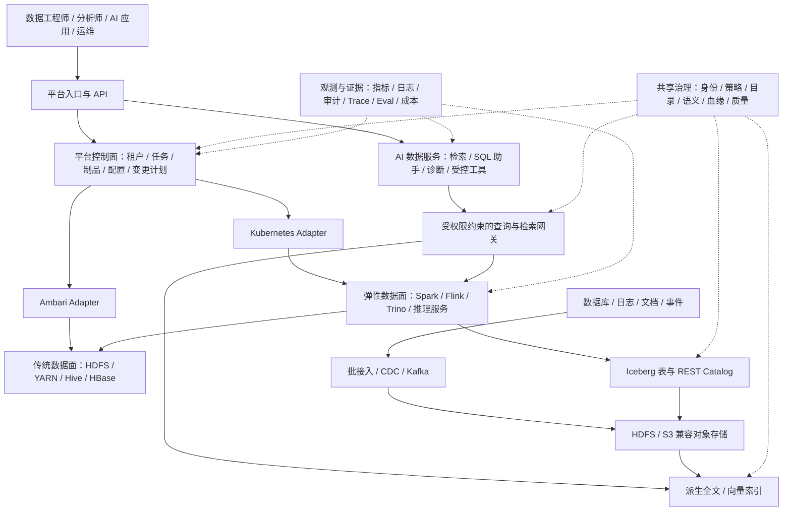

# BIGDATA 下一代数据与 AI 平台 Roadmap

> 更新日期：2026-10-11。状态：规划建议，供版本排期与设计评审使用。
> 当前事实以 main `7a60e8033b94389a13a06d3de455cbae87c55af4`、仓库制品与 CI 证据为基线。
> 未来日期、人员、容量与性能指标是规划假设，尚未构成生产 SLA 或组件兼容性承诺。

## 1. 愿景、用户与成功标准

将 BIGDATA 从可构建、可发布的 Hadoop RPM 发行体系，演进为可私有化交付的**开放湖仓、实时数据与 AI 应用平台**。以现有 openEuler、Bigtop、Ambari、Hadoop 资产为起点，通过统一数据目录、身份、质量、语义与执行接口，使同一批可信数据能服务数仓、实时分析、企业知识检索和受控 Agent。

主要用户是平台运维、数据工程师、分析师和企业 AI 应用团队。第一批场景选择：离线数仓稳定交付、业务数据实时入湖、企业知识检索、受权限约束的 SQL 分析、集群故障诊断。业务领域由试点单位提供，优先选已有数据负责人和可验证答案的场景。

成功以以下结果衡量：

- 新环境能够从冻结制品完成安装、业务验证和故障恢复，交付结果可复现。
- 数据开发、查询、检索和 Agent 使用同一套可审计身份与数据授权，权限在执行端生效。
- 湖仓与实时链路能解释数据来源、版本、时效与质量；AI 回答能回溯到授权数据和证据。
- 版本升级、模型替换和运行时切换有兼容性报告、成本基线与回退方案。
- 每个版本至少交付一个可验收业务闭环，而非仅增加组件数量。

## 2. 当前基线与能力缺口

### 2.1 已有制品和工程证据

| 领域 | 当前基线 | 证据与边界 |
|---|---|---|
| OS 与发行 | openEuler 22.03 LTS SP4、RPM/DNF、Bigtop 3.6.0 构建基线 | 后续新 OS/架构需要独立兼容性认证 |
| Hadoop 生态 | Hadoop 3.4.3、ZooKeeper 3.8.4、Tez 0.10.5、Hive 4.0.1、Spark 3.5.8、HBase 2.6.5 | 这是项目制品版本，并非对 upstream 最新版本的声明 |
| 管理面制品 | Ambari 3.0.0：Server、Agent、Server SPI | 三类 RPM 已入库；不能由包存在推导完整集群管理能力已验收 |
| CI/CD | 组件构建、容器安装/版本冒烟、候选工件、RPM 入库 PR；仓库校验后重入快速通过 | 安装冒烟与真实集群业务/HA 测试分别记录 |
| 包仓库 | 分组件、公共依赖目录、校验和、repodata；排除 debug/test/source/doc/devel 等非运行时包 | 仍需按生产 Profile 验证哪些运行时角色确有必要 |
| 发布 | `BIGDATA-1.0.0-RC1` repo tarball、SHA-256、Release Manifest | GitHub runner 打包；RC1 是候选发布 |

基线证据：

- [RC1 Release 与产物](https://github.com/tommyxie2026-tech/bigdata/releases/tag/BIGDATA-1.0.0-RC1)。
- [四组件完整链路 run 38070123732](https://github.com/tommyxie2026-tech/bigdata/actions/runs/38070123732)。
- [发布提交的主干仓库校验 run 38136996924](https://github.com/tommyxie2026-tech/bigdata/actions/runs/38136996924)：已有合格制品走快速路径，构建/测试/发布的 skipped 不记为新一轮测试通过。
- [RC1 发布 run 38137084676](https://github.com/tommyxie2026-tech/bigdata/actions/runs/38137084676)。

### 2.2 当前优先补齐的缺口

| 优先级 | 缺口 | 下一步及验收依据 |
|---|---|---|
| P0 | 制品发布清单覆盖范围不一致 | main 有 60 个 RPM 条目；Release `rpm_count=27` 仅统计 Tez/Hive/Spark/HBase。工作流打包整个 `repo/`；完整包数、组件 BOM、共用依赖和实际归档必须在 runner 上重新核对并区分 `total_rpm_count` / `validated_component_rpm_count` |
| P0 | RPM 冒烟尚不能证明生产交付 | 从空白主机完成 Ambari 注册、Stack/Service 安装、配置与真实 HDFS/YARN/Hive/Spark/HBase 作业；形成集群验收报告 |
| P0 | HA/恢复与升级证据不足 | 测试 NameNode/ResourceManager 故障、元数据库恢复、HBase RegionServer 恢复、配置回退与升级失败恢复 |
| P1 | 文档与执行基线漂移 | 清理旧 Ubuntu/DEB/JDK 统一假设；按组件冻结 OS、JDK、Python、数据库、架构和兼容组合 |
| P1 | 身份、授权和数据治理缺少生产闭环 | 建立租户、服务账号、执行端授权、审计、资产负责人和数据质量契约 |
| P1 | 缺少面向使用者的数据平台入口 | 提供数据源、目录、任务、查询和资源配额入口，复用开源调度与治理能力 |
| P2 | 湖仓、实时与 AI 的设计尚无集成交付证据 | 通过版本试点逐项认证，不在当前发布范围宣称已支持 |

基线核对只读取 Git/API 文本与元数据；不将仓库指针数视为归档载荷验证，也不要求开发者在本地下载大型 RPM、模型或发布 tarball。

## 3. AI 趋势及本项目的取舍

以下趋势判断依据截至本次调研的公开一手资料；由趋势推导出的产品方向是本项目建议。

| 发展方向 | 一手资料中的事实 | 本项目的产品选择 |
|---|---|---|
| 开放湖仓与多引擎互操作 | Iceberg 定义 REST Catalog API；Polaris 提供基于该接口的 Catalog 能力 [S1][S2] | 默认表格式选 Iceberg，Catalog 与存储独立；先认证 Spark/Trino，不同时维护多套默认表格式 |
| 实时数据成为 AI 上下文来源 | Debezium 支持数据库快照与持续变更捕获 [S3] | 把 CDC、事件时间、删除和权限变更一路传播到湖表及检索索引；索引是派生物，可从可信源重建 |
| Agent 使用企业工具与数据 | MCP 为 HTTP 工具连接定义授权机制；它不是数据权限引擎 [S4] | 通过有身份、有额度、有审计的工具接口暴露查询/检索/任务能力，底层系统仍执行授权 |
| AI 质量需要持续评测 | MLflow 提供评测数据集、评分、人类反馈与调用追踪 [S5] | 模型、提示词、检索配置、数据快照一起版本化；通过评测门禁再上线 |
| 企业语义比直接读表更重要 | dbt 语义模型描述实体、维度和度量 [S6] | 先建设业务词汇与认证指标，再开放 SQL 助手；语义定义与实现可替换 |
| 计算与交付需要多个运行时 | Spark 官方支持 Kubernetes 运行；Flink 持续迭代运行时 [S7][S8] | 保留 YARN/Ambari 管理传统集群，新计算与 AI 服务逐步上 Kubernetes；分别认证 JDK 与连接器 |
| 向量能力可以渐进引入 | pgvector 支持 PostgreSQL 中的精确/近似向量检索 [S9] | 小规模试点优先复用关系库；达到实测容量或延迟边界后再引入专用向量服务 |

不追求“所有组件都最新”。新版本进入候选池后，必须验证 OS/JDK/Python、连接器、数据格式、升级与性能；候选版本不自动成为发行 BOM。特别是 Spark 大版本升级、Flink 大版本升级与 Iceberg 连接器需要单独兼容矩阵。

### 3.1 战略方案比较

| 方案 | 收益 | 成本与限制 | 决策 |
|---|---|---|---|
| 在现有发行底座上逐步叠加开放湖仓和 AI 服务 | 利用已有私有化交付资产，迁移可分批进行 | 需要清晰管理后端边界和双运行时运维 | **推荐主线** |
| 一次性迁到 Kubernetes 并替换全部 Hadoop 能力 | 可统一新运行时 | 存储迁移、网络、HA 和运维成本高，延后业务交付 | 仅用于新建且无历史负担的客户 Profile |
| 全面自研调度、治理、查询和 Agent 框架 | 界面与模型完全可控 | 工作量与维护面过大，难以形成快速试点 | 仅自研项目差异化的控制、交付和策略接口 |

暂不进入主线：基础模型预训练平台、通用 AutoML、默认知识图谱/GraphRAG、三种湖表格式同时生产化、HDFS/HBase 全面容器迁移、无人审批的生产写入或集群自治。

## 4. 目标架构与边界

### 4.1 控制面与运行时

遵循 [ADR-005 后端中立](adr/ADR-005-backend-neutrality.md)：平台核心只管理声明、依赖、计划和执行状态，通过 Adapter 调用 Ambari 或 Kubernetes。同一服务实例只能有一个配置/生命周期管理权威，不能让 Ambari 和 Operator 同时修改它。

- Ambari：继续管理裸机/VM 上传统 Hadoop 服务；保留已部署客户的运维路径。
- Kubernetes：优先承载新查询、目录、任务入口、Flink/Spark 计算和 AI 推理服务。
- S3 兼容对象存储：作为新湖仓与非结构化数据存储接口；S3 API 兼容不等于提交一致性、凭据和恢复语义已认证。
- RPM 与 OCI：双制品轨道，均有 BOM、来源、摘要、签名、扫描、安装/启动验证和离线交付清单。

### 4.2 数据、语义与 AI

结构化数据走“批处理/CDC → 可信湖表 → 认证指标/查询接口”；非结构化数据走“采集 → 解析/OCR → 清洗去重 → 文档版本/权限 → 分块 → embedding → 全文+向量检索 → 重排 → 有引用回答”。OCR、多模态和重排按业务收益逐项启用。

Catalog、业务元数据目录、语义指标、权限策略、血缘各有独立职责，通过稳定资产 ID 关联。Catalog 管表发现与提交，不独自承担所有数据授权；Ranger 等策略组件的插件必须按引擎验证 [S10]。禁止在界面上仅隐藏无权限数据而让执行端仍可读取。

向量索引绑定文档/分块 ID、源版本、embedding 模型及维度、租户、ACL 与删除标记。权限在检索前过滤并在输出前复核；源删除、ACL 撤销、embedding 变更有可追踪重建流程。不得把向量库当作唯一事实源。

### 4.3 Agent 与模型边界

模型网关支持替换供应方或自托管运行时，统一超时、重试、租户额度、成本与脱敏。敏感数据是否允许出域由部署 Profile 明确；离线环境使用经过许可证、硬件和评测认证的本地模型。

Agent 权限分级：L0 只读建议；L1 生成 SQL/配置/PR 供人审查；L2 经审批执行白名单操作并可回退。生产写入、服务重启、权限扩大和数据删除必须走现有变更控制。工具调用需要独立身份、短时凭据、超时、幂等键、配额和审计，不能共享管理员凭据。

## 5. 版本节奏与阶段 Gate

以 8–10 名核心全职成员、已有测试硬件及一个业务试点为排期假设。目标窗口约 15–18 个月；月份用于容量规划，**阶段退出条件决定上线**。团队只有 3–4 人时先聚焦 GA、单条湖仓链路和一个 AI 场景，重新估算后续窗口。

| 版本 / Gate | 目标窗口 | 版本定位 | 可见成果 | 进入下一阶段的条件 |
|---|---|---|---|---|
| 1.0 GA / G0 | 2026 Q4–2027 Q1 初 | 可靠的 Reference Distribution | 完整离线 repo、真实集群安装、HA/备份恢复、交付手册 | 制品/安装/业务/恢复四类证据齐全；安全基线和已知限制可接受 |
| 1.1 / G1 | 2027 Q1 | 可治理的 Composable Platform 基础 | Profile/Adapter 契约、身份/租户、调度/目录/质量、只读诊断试点 | 至少两个租户隔离验证；任务补数重跑与审计闭环 |
| 2.0 / G2 | 2027 Q2 | 开放 Lakehouse | Iceberg+Catalog+对象存储；Spark/Trino 查询；Hive 迁移样板 | 多引擎一致性、权限、表维护和回退通过 |
| 2.1 / G3 | 2027 Q3 | 实时与混合运行时 | CDC+Kafka+Flink 入湖；Kubernetes Adapter 与弹性计算 | 72 小时稳定性、故障重放/恢复、双运行时升级演练通过 |
| 2.2 / G4 | 2027 Q4 | AI-ready Data Platform | 文档/RAG、语义 SQL 助手、模型网关、Trace/Eval | 两个试点在质量/权限/时延/成本门禁下通过 |
| 3.0 / G5 | 2028 Q1 | Hybrid Data & AI Platform | 受控 Agent、跨运行时任务、版本化上下文与容量建议 | 受控执行、回退、越权/注入测试、生产试点通过 |

与旧路线图的映射：1.x 继续发行与平台底座；2.x 将原可组合平台目标细化为湖仓、实时、AI-ready 三个增量；3.0 保留 Hybrid Data Platform 定位并增加受控 AI 能力。原 Phase 文档用于技术背景，本文件统一后续版本排序。

### 5.1 1.0 GA：从包交付到可恢复集群

- 在空白 openEuler 环境从 tarball 发布 DNF 仓库，校验全部组件/公共包、SHA256SUMS、repodata、RPM 依赖与完整 BOM。
- 产出可执行的 Ambari Stack/Service、Blueprint 与环境预检；验证 SPI 和管理服务兼容。
- 单节点用于功能验证；3 Master + 3 Worker + 1 Gateway 用于 HA 验收，明确网段、DNS、NTP、磁盘和外部元数据库要求。
- 验证 HDFS 读写/YARN 任务/Hive SQL/Spark 作业/HBase CRUD，进行节点故障、服务恢复、数据库备份恢复和配置回退。
- 将 JDK/Python 等运行时按组件分离；敏感生产 Profile 启用认证、传输保护和审计。
- 发布冻结清单、签名与许可证清单、已知限制、安装/升级/回退/恢复手册和验收报告。

**G0**：两次独立空白环境安装成功；关键恢复演练有时间线与数据一致性结果；无未关闭的阻断问题。仅安装/版本冒烟不能满足 G0。

### 5.2 1.1：治理、开发入口与可组合平台

- 实现最小 Platform Core：Profile 解析、依赖计划、dry-run、执行状态、审计和 Ambari Adapter；先提供 CLI/API，再补统一界面。
- 选择一个调度平台、一个元数据目录与身份提供方；通过 PoC 对比后冻结，不同时维护两套生产实现。
- 落地租户/服务账号、队列配额、数据资产负责人、数据契约、敏感分类和基础血缘。
- 集成源控制、SQL/Spark 作业模板、测试、调度、补数、告警和数据质量隔离区。
- 用已有 runbook 和脱敏日志做只读运维问答试点，收集真实失败案例，提前建立 AI 评测集。

**G1**：两个租户访问相同测试数据时授权结果正确；20 个代表任务支持失败重试/补数/审计；10 张核心表具备 owner、契约、质量规则与血缘。数量是首版验收规模，可经评审调整。

### 5.3 2.0：开放湖仓与统一查询

- 默认 Iceberg，PoC 选择并冻结一个 REST Catalog 实现；Polaris 为候选，Hive Metastore 保留既有表兼容入口 [S1][S2]。
- 认证对象存储、Spark/Iceberg 连接器、Trino 与 Catalog 的组合；提供 schema/分区演进、快照、并发提交、小文件合并和快照清理。
- 选一个 Hive 主题域迁移：盘点表类型/SerDe/SQL，建立基线，分批迁移、双读校验、切换与回退。Hive ACID/外表分别评估，不做无验证的原地转换。
- 推进数据目录、引擎授权与业务指标一致性；API 查询设置扫描量、并发、超时与租户预算。

**G2**：100 条代表 SQL 在 Spark/Trino 上满足定义的一致性/精度规则；10 类表演进及并发场景通过；7 天负载测试完成；迁移差异均可解释并可回退。性能以同硬件、同数据和固定并发比较。

### 5.4 2.1：实时上下文与混合云原生

- CDC → Kafka → Flink → Iceberg 先打通一个数据库来源和一个业务主题，认证 update/delete、主键变化、schema 变化和迟到数据。
- 定义快照与增量衔接、offset/checkpoint/savepoint、幂等写入、故障重放、死信/隔离区和源端日志保留。
- “Exactly-once”按完整源/连接器/计算/提交链路验证；无法保证的路径采用明确的至少一次+幂等契约。
- 新 Spark/Flink/Trino 与平台无状态服务在 Kubernetes 上试点；HDFS/HBase 留在已验证的裸机/VM 轨道。
- 提供 OCI/Helm/Operator 的版本与 CRD 升级契约、离线镜像仓库、持久卷/对象存储、网络与故障域验证。

**G3**：约定负载下 CDC 到可查询数据的 P95 延迟 ≤60 秒；72 小时运行中完成进程/节点/网络故障演练；源端和湖表主键/删除对账无未解释差异。恢复不能超过业务批准的停机窗口；不能仅以 checkpoint 成功率证明端到端正确性。

### 5.5 2.2：企业 AI 数据服务

- 交付授权文档检索：解析、去重、分块、embedding、混合检索、重排、有引用回答、不可回答时拒答；建立索引更新与删除 SLA。
- SQL 助手从认证指标和只读 SQL 开始：显式业务语义、schema 检索、SQL 解析/策略验证、EXPLAIN、扫描预算、用户确认和受限执行。
- 模型网关接入一个本地推理后端和一个可选远端后端；外发策略、模型许可证、离线权重、GPU 驱动依赖都进入交付 Profile。
- 用 MLflow 或经评审的等价能力管理提示词、评测集、Trace 和质量门禁；OpenTelemetry 关联数据任务、检索、工具和模型调用 [S5]。
- 为传统 ML 团队提供数据快照/特征导出、实验记录与批量推理；在线 Feature Store 仅在真实低延迟场景需要时纳入。

**G4**：不少于 200 条经业务专家标注的保留测试集；RAG 引用支持率 ≥95%、不可回答问题正确拒答率 ≥90%；SQL 按结果判定正确率 ≥85%。召回、时延、成本分别记录；越权负例零成功。自动评审评分必须与人类抽检校准，提示词开发集与上线验收集隔离。

知识问答与 SQL 各至少 100 条，另设不少于 50 条权限/注入/删除负例。引用支持率按“需要证据的事实断言中被引用内容支持的比例”计算；拒答率只针对标注为不可回答的子集；SQL 正确率比对批准数据快照上的结果与数值容差。每类指标同时报告样本数，零次越权仅代表该测试套件结果，不推导生产绝对保证。

### 5.6 3.0：受控 Agent 与协同运维

- 建立标准工具目录，可通过 MCP 提供目录搜索、只读查询、任务状态、指标/日志和变更计划；认证、数据授权与配额在工具端执行 [S4]。
- 数据 Agent 生成质量规则、SQL、工作流或修复 PR；人审后执行，记录计划、输入版本、工具结果与变更摘要。
- 运维 Agent 先只读诊断，再对已验证白名单动作提供审批执行、幂等、回退和熔断；诊断置信度低时转人工。
- 长期状态放在有租户隔离与保留策略的状态库；不依赖模型会话保存生产状态。关联湖表快照、文档版本、模型和工具版本以便重放。
- 在实测成本模型基础上建议容量和资源调整；建议必须可解释，实际扩缩容受预算与变更策略约束。

**G5**：不少于 50 类批准的操作/分析场景，任务完成率 ≥90%；越权、提示注入、重复执行、超时和回退套件通过；所有写操作都有审批记录、执行身份和前后证据；至少一个生产试点完成业务复盘。

## 6. 可组合交付 Profile

| Profile | 必要能力 | 首次交付版本 | 运行时与资源边界 |
|---|---|---|---|
| warehouse-ha | Hadoop/ZooKeeper/Hive/Tez/Spark，HBase 按业务选配，Ambari | 1.0 GA | 裸机/VM；认证基础运行时；不要求 GPU |
| governed-data | 身份、目录、调度、质量、审计和租户配额 | 1.1 | 管理服务可独立 VM，随后容器化 |
| open-lakehouse | Iceberg/Catalog/对象存储/Spark/Trino | 2.0 | 独立存储与计算；不强制附带全部 Hadoop 服务 |
| realtime-lakehouse | CDC/Kafka/Flink、入湖质量与恢复 | 2.1 | Kafka 状态盘、Flink 状态与 checkpoint 独立规划 |
| ai-knowledge | 文档管道、检索索引、模型网关、评测/Trace | 2.2 | CPU 检索与 GPU 推理池分离；可纯远端模型，但需出域批准 |
| governed-agent | 工具接口、审批、沙箱/额度、重放与变更控制 | 3.0 | 使用者身份贯穿数据/工具/推理；不授予集群管理员通用权限 |

每个 Profile 都交付组件 BOM、运行时兼容矩阵、依赖、配置、健康检查、容量模板和退出/回退说明。共用包和 OCI 基础镜像只存一份引用；完整离线包按 Profile 生成。生产不默认安装 pseudo/单机配置或所有网关角色。

## 7. 首个 90 天执行 Backlog

下表是建议排期，未自动创建 Issue。Owner 是负责角色，人员姓名在版本启动时分配。D0 为正式启动日期；两个星期一次演示，30/60/90 天分别评审。

| ID | 优先级 / 窗口 | 工作包 | Owner | 依赖 | 可验收结果 |
|---|---|---|---|---|---|
| R01 | P0 / D1–14 | 完整 Release BOM、包数/摘要/repodata 一致性 | 发行负责人 | 现有 RC1 | runner 中逐个核对全部归档载荷；清单覆盖 Ambari/Hadoop/ZooKeeper/common 与四组件；修正计数含义 |
| R02 | P0 / D1–14 | 文档、版本矩阵与生产 Profile 对齐 | 架构+交付 | R01 | 当前默认 openEuler/RPM 与每组件运行时一致；旧设计有历史标签；输出待认证项 |
| R03 | P0 / D8–30 | 干净环境安装与真实业务验证 | 集群+QA | R01/R02 | Ambari/Stack/仓库完整安装；HDFS/YARN/Hive/Spark/HBase 场景报告；无手工隐藏步骤 |
| R04 | P0 / D20–45 | HA、备份恢复、升级/回退 | SRE+QA | R03 | 故障注入与数据对账；RTO/RPO 实测；GA 阻断问题列表 |
| R05 | P1 / D15–45 | 身份/租户/授权方案 PoC | 治理负责人 | R02 | 两租户、服务账号、TLS/审计、执行端拒绝验证；生产安全基线 |
| R06 | P1 / D30–60 | Profile/Adapter/API 最小控制面设计与样板 | 平台工程 | R03 | dry-run 计划、幂等执行与状态/审计契约；Ambari 适配边界 |
| R07 | P1 / D30–60 | 调度/目录/质量的单一候选验证 | 数据工程 | R05 | 20 作业+10 核心表闭环；给出 license/依赖/运维成本 ADR |
| R08 | P1 / D40–75 | Iceberg/Catalog/Spark/Trino 兼容样板 | 湖仓工程 | R05/R07 | 一个主题域、100 条代表 SQL、提交/恢复/权限测试；冻结候选组合 |
| R09 | P2 / D45–80 | 企业知识/运维诊断只读 AI 验证 | AI+业务专家 | R05/R07 | 授权 runbook/文档问答；200 条评测集草案，记录基线质量与成本 |
| R10 | P1 / D60–90 | GA/下一版立项与资源报告 | 产品+SRE+QA | R01–R09 | GA Gate 决策；湖仓与 AI 是否继续的证据；未来 2 个季度容量与人员预算 |

最短关键路径为 R01 → R03 → R04 → G0；治理与湖仓样板可在可用测试环境上并行，但不得占用恢复演练必须资源。R09 失败不阻塞 1.0 GA，它决定后续 AI 场景是否继续投入。

## 8. 人员、基础设施与成本评估

### 8.1 人员与交付容量

| 职能 | 建议投入（FTE） | 主责 |
|---|---|---|
| 产品/架构 | 1 | 试点价值、边界、ADR、Gate 与验收指标 |
| 发行/集群工程 | 1.5 | BOM、CI/CD、RPM/OCI、Ambari/运行时适配 |
| 平台/API/交付入口 | 1.5 | Profile、Adapter、任务、租户与界面集成 |
| 数据/湖仓/实时工程 | 2 | 批流链路、迁移、目录、质量与语义 |
| AI 应用工程 | 1 | RAG/模型网关/工具、评测数据与性能 |
| SRE/治理 | 1–1.5 | HA、可观测、身份授权、恢复与容量 |
| QA/性能 | 1 | 可重复测试、兼容性、故障注入、性能与升级 |

合计约 9–9.5 FTE；业务专家另需每个试点每周 0.5–1 天用于答案标注与结果验收。可合并角色，但工时不能重复计数；每轮排期预留约 20% 给维护、依赖适配和缺陷。跨阶段新增组件前先评估长期维护人力。

### 8.2 环境资源起点

下表是压测前的预算样板，不是采购规格。CPU 为 vCPU，内存为 GiB；共享现有资源应扣除实际可用余量。生产按故障域与峰值负载核算。

| 环境 | 计算参考 | 存储/网络参考 | AI 资源 |
|---|---|---|---|
| 开发/功能 PoC | 3–4 台 VM，每台 8–16 vCPU/32–64 GiB | SSD 0.5–1 TB/台，千兆仅用于低负载开发 | 先远端模型或共享测试 GPU；不作为 HA 证据 |
| 传统 HA 验收 | 3 Master：8–16/32–64；3 Worker：16–32/64–128；1 Gateway：8/16–32 | Master 元数据 SSD；Worker 数据盘按数据量；10 GbE 起点评估 | 0 GPU |
| 湖仓/实时试点 | 在稳定底座之外预留 3–6 台 16–32/64–128 的计算节点 | 独立对象存储与 Kafka 盘；按吞吐、状态、保留期核算 | 先不采购专用 GPU |
| AI 试点 | CPU 检索/解析 2–3 台 8–16/32–64；状态库独立实例 | 索引 SSD、模型缓存与文档源容量分开 | 1–2 张 24–48 GiB GPU 仅作小模型试点起点，需实测模型/量化/上下文/并发；单卡无 HA |
| 生产 | 计算池按查询/任务/租户峰值和 N-1 故障余量扩展 | 数据、checkpoint、备份、日志、索引分别预算；跨故障域 | 冗余推理实例与独立 GPU 节点池，按通过 SLA 的吞吐扩容 |

### 8.3 可复算的容量模型

统一使用十进制 TB/GB 计算磁盘例子；GiB 用于硬件内存。输入需要来自实际样本，压缩比、索引系数与利用率都应在压测报告中记录。

**湖仓/数仓磁盘**：`S_logical = 日增量 × 保留天数 × 落盘压缩比 × 版本/临时空间系数`；`S_raw = S_logical × 冗余开销 / 目标利用率`。HDFS 三副本的冗余开销为 3；对象存储按所选纠删码或副本实现计算。备份另计，不再重复乘同一存储层的冗余。

例：每日原始 1 TB、180 天、压缩比 0.35、额外空间系数 1.2、利用率 70%，需要约 108 TB 可用容量；若采用 HDFS 三副本，约 324 TB 原始盘。异地备份、暂存/迁移双份数据与增长余量另算。

**Kafka**：`S_raw ≈ 保留窗口平均入站字节/秒 × 保留秒数 × 副本数 / 利用率`，写入/网络带宽单独用峰值和复制流量计算。平均 20 MB/s、保留 24 小时、三副本、70% 利用率约 7.4 TB；未含索引、段开销与增长余量。

**Flink/批查询计算**：记录状态量、checkpoint 时长/间隔、恢复速度、窗口与乱序上限；批作业记录 shuffle/扫描量和峰值并发。以 N-1 故障后的任务/查询 SLO 为准，不按数据 TB 数直接推导 CPU 数。

**向量索引**：`S ≈ 分块数 × 向量维度 × 每维字节 × 索引放大系数 × 副本数 / 利用率`。1000 万分块、1024 维 float32、系数 1.5、两份副本、70% 利用率约 176 GB；元数据、全文索引、原文、构建临时空间和内存工作集另计。ACL 过滤下召回与延迟必须压测。

**GPU**：权重下限 `参数量 × 每参数字节`；8B 模型 BF16 权重约 16 GB。显存还需 KV cache、运行时与 batch/上下文余量，不能据权重大小直接承诺单卡并发。记录输入/输出 token、上下文长度、TTFT（首 token 时延）、tokens/s、排队与故障切换；embedding、重排、生成分别算预算。

### 8.4 成本与扩容门槛

月度 TCO = 人员 + CPU/内存/存储 + GPU + 网络 + 备份 + CI runner/制品 + 许可证/支持。远端模型费用按各模型实际价目和输入/输出 token 分开计，缓存命中和失败重试也计入。使用“每成功任务/每千次合格回答/每 TB 有效数据”的单位成本，不只比较 token 单价。

扩容触发以连续负载证据判断：N-1 状态下超出 SLO、持续排队、磁盘达到预留阈值、checkpoint 超出恢复预算或 AI 成本超过租户额度。先优化小文件、分区、索引、模型路由和批处理，再增加资源；节省量需要同基准复测。

## 9. 验证、可观测与发布治理

### 9.1 证据等级

| 等级 | 证明能力 | 典型证据 |
|---|---|---|
| E0 | 构建可复现 | 编译/打包日志、来源、依赖和摘要 |
| E1 | 制品可安装 | 干净环境依赖解析、安装、版本与基本健康检查 |
| E2 | 场景可用 | 真实集群读写/作业/查询/CDC/检索及权限测试 |
| E3 | 生产可运维 | HA、备份恢复、升级/回退、长稳、容量与安全评测 |

当前组件 CI 主要证明 E0/E1；每个能力的 E2/E3 状态单独登记。快速路径复用的是匹配条件下已有证据，不能产生新测试证据。生产 Profile 需要具备其声明范围的 E3。

### 9.2 CI 重入与证据失效

保留“版本未变且 repo 合格则快速通过”的体验。随着平台升级，合格定义扩展为：组件版本/Release/架构、OS/运行时、构建输入摘要、依赖 BOM、Profile 包集合、校验和/元数据和关联测试证据均匹配。

构建脚本、补丁、关键依赖、运行时、权限配置或部署拓扑发生相关变化时，旧证据失效；定期进行强制冷构建与完整场景测试。显式记录 `repo_verified`、`artifact_reused`、`tests_executed`、`tests_reused`，不能把 skipped 统一涂成“测试 PASS”。API/OCI/模型/提示词也使用相同制品与证据追踪原则。

### 9.3 指标与建议目标

下列是首批试点目标；上线前按固定数据集、模型、硬件、并发、权限条件和测量窗口冻结。

| 范围 | 核心指标 | 建议门槛 |
|---|---|---|
| 交付 | 干净安装成功率、手工步骤、失败可定位性 | 两次独立安装全部必选场景成功；步骤可脚本化重放 |
| 数据服务 | 成功率、P95/P99、扫描量、并发、租户额度 | 首版月可用性目标 99.9%；需试点数据支持后才转 SLA |
| 恢复 | RTO/RPO、切换后数据一致性 | 首版关键控制服务 RTO ≤30 分钟、可备份元数据 RPO ≤15 分钟；仅限批准故障场景，数据面分开定目标 |
| 实时 | 源到查询新鲜度、积压、丢失/重复、删除传播 | G3 负载下 P95 ≤60 秒；对账无未解释差异 |
| RAG | Recall@k、引用支持、拒答、权限泄漏 | G4 质量门禁；检索 P95 ≤1 秒作为试点目标；不能只评估语言流畅度 |
| 生成 | TTFT、完整回答时延、单位合格回答成本 | 固定小模型场景 TTFT P95 ≤3 秒、完整回答 P95 ≤15 秒作为试点目标 |
| Agent | 完成率、错误工具调用、审批率、回退 | G5 完成率门禁；生产写入审批与审计覆盖 100% |

数据/AI 服务关联统一请求 ID；模型 Trace 对敏感内容做最小化采集和访问控制。观测本身不成为新的数据泄漏通道。

### 9.4 发布与支持策略

- 当前 RC1 保持不可变；缺陷通过后续 RC/正式版本修复并给出迁移说明。
- 两周迭代、每月依赖/CVE/兼容性检查、每季度候选功能版本；阻断缺陷按修复证据发布补丁。
- 维护一条稳定生产 BOM 和一条候选验证 BOM；支持窗口在 GA 前根据人力与 upstream 生命周期确定。
- 每次发布有全组件/全 Profile 清单、签名/校验、SBOM、版本/兼容/升级报告与可定位证据。
- RPM/OCI/模型/文档大产物的下载、校验、打包与发布在 runner 或授权交付环境完成。

## 10. 风险、止损与重排规则

| 风险 | 触发信号 | 调整措施 |
|---|---|---|
| 组件扩张超过维护能力 | 一个版本同时引入多个未认证引擎/治理实现 | 一个默认表格式、Catalog、调度与目录实现；其他进入可选 Profile |
| 编译成功被当作交付成功 | 缺少服务运行、真实数据与故障报告 | 用 E0–E3 分级，G0 不豁免业务/恢复验证 |
| JDK/连接器/OS 兼容断裂 | 大版本升级导致现有作业/包失效 | 新旧 Profile 并存、独立验证后迁移，保留回退窗口 |
| 实时数据/权限删除不一致 | 湖表与索引残留数据、断点不可恢复 | 源版本/删除事件/权限版本追踪、重建、隔离与对账 |
| AI 演示好但业务不达标 | 保留集正确率低、缺引用、成本失控 | 返回数据/语义/检索改进；未过 G4 不扩展 Agent 写权限 |
| 租户越权/提示注入 | 不可信文档诱导执行或泄漏上下文 | 执行端授权、工具白名单与沙箱、红队/负例、异常熔断 |
| 双控制面争夺配置 | Ambari 与 Operator 对同一实例反复覆盖 | 单一 owner、Adapter 边界、配置漂移审计 |
| 无业务 owner 或硬件资源 | 数据/标注/测试环境持续缺失 | 暂停该场景进入下个 Gate；资源转向可验证的交付与治理能力 |

每个 Gate 允许 GO / CONDITIONAL_GO / HOLD；CONDITIONAL_GO 必须列出限定 Profile、缺口、owner 和截止期。不得用发布日期替代质量判定。

## 11. 文档组织与下一步设计

本文件统一跨版本愿景、排序、资源假设和 Gate；[项目 Roadmap](../project/ROADMAP.md)、[产品 Roadmap](product-roadmap.md)、[历史阶段路线](roadmap.md) 保留为原规划记录并链接到本文件。与现有 ADR 冲突时先更新 ADR，再实施。

下一批建议文档及其作用如下；这些路径是待创建交付项：

| 计划文档 | 首次版本 | 必须回答的问题 |
|---|---|---|
| `docs/delivery/production-acceptance.md` | 1.0 GA | 空白安装、业务、HA、恢复和升级证据如何验收 |
| `docs/delivery/full-release-manifest.md` | 1.0 GA | 全部组件、共用依赖、Profile、摘要与实际归档如何一致 |
| `docs/platform/identity-and-governance.md` | 1.1 | 身份如何贯穿任务、查询、目录、工具与检索 |
| `docs/platform/profile-adapter-contract.md` | 1.1 | 谁管理配置，哪些动作支持幂等/回退与状态恢复 |
| `docs/lakehouse/catalog-and-migration.md` | 2.0 | Catalog、引擎、对象存储和 Hive 迁移的认证边界 |
| `docs/streaming/cdc-correctness-and-recovery.md` | 2.1 | 快照、增量、DDL、删除、乱序和故障一致性如何验证 |
| `docs/ai/context-evaluation-and-cost.md` | 2.2 | 数据/语义/模型/提示词/索引如何版本化及评测 |
| `docs/ai/tool-authorization-and-change-control.md` | 3.0 | Agent 如何获得最小权限并审批、执行、审计、回退 |

每项先产出可评审设计与最小验收样板，再安排工程实施。此 roadmap 不直接触发组件升级、基础设施采购或生产配置变更。

## 12. 一手资料与调研日期

调研日期：2026-10-11。下列资料支持技术方向，不代表本项目已经认证其中产品或最新版本。进入实施时应固定使用版本和文档快照。

- **[S1]** [Apache Iceberg REST Catalog 规范](https://iceberg.apache.org/rest-catalog-spec/)：表元数据与 Catalog 接口边界。
- **[S2]** [Apache Polaris](https://polaris.apache.org/)：开放 Catalog 候选与互操作方向。
- **[S3]** [Debezium PostgreSQL Connector](https://debezium.io/documentation/reference/stable/connectors/postgresql.html)：快照、变更捕获、源端限制与恢复边界。
- **[S4]** [MCP 授权规范，2026-07-28](https://modelcontextprotocol.io/specification/2026-07-28/basic/authorization)：HTTP 工具连接的身份与授权协议。
- **[S5]** [MLflow LLM/Agent 评测](https://mlflow.org/docs/latest/genai/eval-monitor/)：数据集、评分、反馈、追踪与生产观测。
- **[S6]** [dbt Semantic Models](https://docs.getdbt.com/docs/build/semantic-models)：实体、维度、度量等业务语义建模。
- **[S7]** [Spark on Kubernetes](https://spark.apache.org/docs/latest/running-on-kubernetes.html)：容器运行与资源/部署要求，实施需匹配具体 Spark 版本文档。
- **[S8]** [Flink 2.3.0 发布公告](https://flink.apache.org/2026/06/25/apache-flink-2.3.0-release-announcement/)：持续演进的流批运行时；版本选择仍以项目兼容验证为准。
- **[S9]** [pgvector 官方仓库](https://github.com/pgvector/pgvector)：关系库集成向量检索的能力与限制。
- **[S10]** [Apache Ranger](https://ranger.apache.org/)：数据访问策略与审计能力，集成插件按引擎认证。
