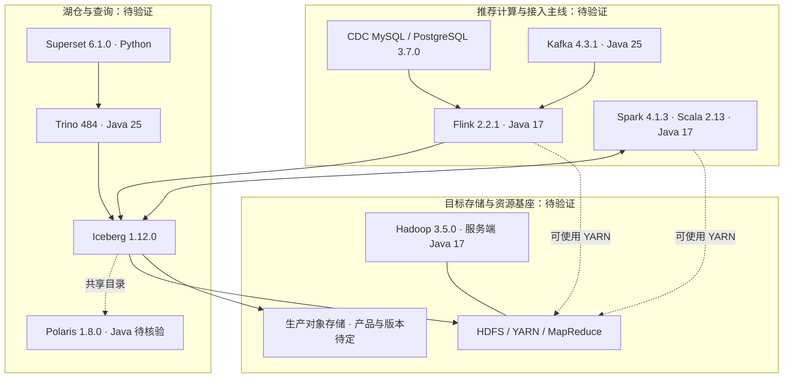

# 下一代目标版本与 Java 矩阵

更新时间：2026-10-24（Asia/Tokyo）。决策基础：Hadoop 3.5.0 作为目标基座；允许组件按需退出或替换。

**状态：目标选型，待构建、安全扫描和集成回归；不表示已发布或已完成升级。** 当前实际交付仍见[已发布版本矩阵](version-matrix.md)，选型证据及安全升级详见[版本评估](component-version-assessment-20261023.md)。官方未列出精确组合时标为待验证，不预先判定不兼容；已有明确二进制约束仍须遵守。

## 目标架构图

图中连接表示职责与接入关系，不表示所有数据经过 catalog。HDFS 与对象存储是按部署选择的存储路径，不要求双写；不需要 YARN 的部署可单独选择资源调度方式。

## 组件版本矩阵

| 组件 | 当前交付 | 下一代目标 | 范围与状态 |
|---|---|---|---|
| Hadoop / HDFS / YARN / MR | 3.4.3 | **3.5.0** | 目标基座；服务端及客户端依赖分别验证与扫描 |
| Spark | 3.5.8 | **4.1.3 / Scala 2.13** | 推荐主线；4.2.0 后续试验，现有湖仓配套尚未完整列出 |
| Flink | 1.20.1 | **2.2.1** | 推荐主线；匹配 CDC/湖仓连接器，不直接追 2.3 |
| Flink CDC MySQL / PostgreSQL | 3.4.0 | **3.7.0** | 推荐主线；两种源分别回归 |
| Kafka | 3.4.1 | **4.3.1 / KRaft** | 推荐主线；连接器、事务与恢复待测 |
| Iceberg | 1.12.0 | **1.12.0** | 默认表格式；新引擎对应 runtime 必须重新判断构建 identity |
| Trino | 483 | **484** | 推荐查询入口；精确插件版本独立核验 |
| Polaris | 未交付 | **1.8.0** | 新增目录候选；持久化、授权与恢复待实现/验证 |
| Superset | 未交付 | **6.1.0** | 新增 SQL/BI 候选；不替代全部作业管理功能 |
| ZooKeeper | 3.8.4 | **3.8.7** | HDFS HA/HBase 等需要时安装；3.9.6 另作候选 |
| Hive / Metastore | 4.0.1 | **4.2.1** | 按存量 SQL 需要保留；与 Hadoop 3.5 组合待测，未预判冲突 |
| Tez | 0.10.5 | **0.10.5** | Hive 执行配置可选；JDK 配套待测 |
| HBase | 2.6.5 | **2.6.7** | 在线宽表业务可选；3.0.0 独立迁移评估 |
| Paimon | 2.1.0 | **2.1.0** | 实时主键表可选；不默认维护第二套完整链路 |
| Hudi | 1.2.1 | **1.2.1** | 独立可选；不纳入默认 Flink 2.2 链路，已列出 runtime 未覆盖它 |
| Ambari | 3.0.0 | **3.0.0** | 传统管理可选；Hadoop 3.5 服务定义与启动参数待适配 |
| Bigtop / common | 3.6.0 | **3.6.0 配方扩展** | 保留发行能力；BOM 不等于新组合已认证 |
| Ambari Metrics | 3.0.0 | 暂保留 **3.0.0**，隔离维护 | 传统管理可选；旧内嵌 HBase/Phoenix 不纳入新 Java 通用基线 |
| Hue | 4.11.0 开发快照，RPM release 2 | 存量隔离，不作为新默认入口 | Superset 只替代 SQL/BI 部分，其他功能另评估 |
| S3A AWS SDK | 2.35.4 | **2.35.4，随 Hadoop 3.5 POM 复核** | 不是 SDK 最新版；按有效依赖树与 CVE 核验，不盲目替换 |
| 生产对象存储 | 尚未选型 | **待定** | 测试 SeaweedFS fixture 不作为生产版本承诺 |

## Java 版本评估矩阵

原则是 **Java 17 覆盖 Hadoop/计算基线，Java 21 满足特定服务，Java 25 服务现代查询与消息组件**。不是统一切换全局 JAVA_HOME。下表 Java 数字指主版本；精确安全补丁、厂商 build 和 checksum 尚未冻结。

| 组件 / 进程 | 官方要求或已核验范围 | 本平台运行候选 | 构建与验证边界 |
|---|---|---|---|
| Hadoop 3.5 服务端 | Java 17 必需 | **17 最新可用安全补丁** | 独立配方验证编译器、native 与启动参数，退出全局 JDK 8 假设 |
| Hadoop 3.5 客户端 | Java 17 / 21 | **17**；Hive 进程内可评估 **21** | 每个应用实际依赖树分别核验，不统一覆盖分发包 JAR |
| Spark 4.1.3 driver/executor | Java 17 / 21 | **17**；21 作后续可选配置 | 编译产物/Scala/UDF 一致；driver、executor 与 YARN 容器显式配置 |
| Flink 2.2.1 JM/TM / CDC | 推荐 Java 17；21 为实验支持 | **17** | 应用与连接器字节码须可运行于 17；Hive 等集成仍有未测试项 |
| Kafka 4.3.1 broker/controller | Java 17 / 21 / 25；官方推荐最新 LTS 25 | **25** | Kafka JVM 与 Flink Kafka 客户端 JVM 独立；客户端 Java 17 不必跟随 broker 切 25 |
| Trino 484 | Java 25，最低 25.0.1；建议最新补丁 | **25**，优先 Temurin | 插件构建与运行按 Trino SPI/工具链锁定；不强制切 Java 26 |
| Hive 4.2.1 | 最低 Java 21 | **21** | 与 Hadoop 客户端支持范围有交集；Tez 容器及 Hadoop 3.5 集成单独验证 |
| Polaris 1.8.0 | 本轮尚未确认正式 tag 的完整构建/运行要求 | **待核验，不默认填 17/21/25** | 进入构建前核对正式源码工具链、发行镜像与启动要求，镜像摘要独立锁定 |
| Iceberg / Paimon / Hudi runtime | 由对应引擎、artifact 与插件约束共同决定 | 随实际宿主 JVM | 不为表格式虚构独立通用 JDK；构建 JDK 与目标字节码分别记录 |
| Ambari 3.0.0 | 当前管理端以 Java 17 交付 | **17**，新组合待测 | 不据管理端版本推断所有服务必须同一 JDK |
| HBase 2.6.7 / Tez / ZooKeeper | 精确所选 tag 的范围需专项复核 | **待专项冻结** | 不根据 Hadoop 已切 17 就宣称这些服务已支持；保留项必须通过验收 |
| Metrics Collector | 当前交付 Java 8，内嵌旧存储 | **旧配置隔离，待整改/替换** | 不进入新默认 Java 基线；安全扫描和维护责任独立保留 |
| Hue / Superset | Python 应用 | **不适用** | 访问 Trino 不等于自身需要 Java 25；Python/驱动另行锁定 |

### JDK 发行版与安全补丁策略

- Trino 优先采用官方测试的 Eclipse Temurin；其他服务优先评估同厂商 OpenJDK 构建，OS 仓库版本可作替代，但须验证支持与安全回补记录。不将 Oracle JDK 商业支持条款与所有 OpenJDK 发行版混为一谈。
- 实施冻结时读取厂商当期发布信息，记录完整版本、build、架构、URL、SHA256、许可证及安全公告；不把今天的补丁号长期写死为“最新”。当前文档没有确认某个具体补丁号为最新，也没有宣称 CVE 清零。
- 运行和构建分开登记：构建工具链、编译目标字节码、实际运行 JVM 三者分别锁定；不能因 JDK 25 可以编译就把 Java 25 字节码交给 Java 17 执行。
- 每个 systemd 服务、Ambari 服务环境、CI job 与 YARN 应用显式绑定 Java；禁止全局 alternatives 切换影响全部服务。组件内不拼接其他服务的 classpath。
- 每次安全补丁更新先做启动、TLS/Kerberos、native、查询与作业恢复回归；保留旧镜像/包的 checksum 和回退时限。Java 8/11 旧配置不再自动进入新部署默认项。

## 冻结顺序

1. Hadoop 3.5.0 / Java 17：安全差异、HDFS/YARN/MR、HA、回退。
2. Spark 4.1.3 / Flink 2.2.1 / Iceberg：客户端、数据正确性及恢复。
3. CDC / Kafka / Trino：认证、事务、精确查询与失败恢复。
4. Polaris / Superset 及实际保留组件：目录、权限、运维与数据迁移。

上游未提供精确组合认证的部分，通过上述验证形成平台自己的兼容矩阵；有明确接口/字节码限制的部分先调整配套。只更新文档不会改变既有包的发布状态。

## 官方 Java 与版本证据

- [Hadoop 3.5 Java 17/21 与安全变更](https://hadoop.apache.org/docs/r3.5.0/)
- [Spark 4.1.3 Java 17/21、Scala 2.13](https://spark.apache.org/docs/4.1.3/)
- [Flink 2.2 Java 17 推荐、21 实验限制](https://nightlies.apache.org/flink/flink-docs-release-2.2/docs/deployment/java_compatibility/)
- [Kafka 4.3 Java 支持及 LTS 建议](https://kafka.apache.org/43/operations/java-version/)
- [Trino 484 Java 25 与 Temurin 建议](https://trino.io/docs/current/installation/deployment.html)
- [Hive 4.2.1 发行要求](https://hive.apache.org/general/downloads/)
- [完整组件版本来源与 Hadoop 安全评估](component-version-assessment-20261023.md)
